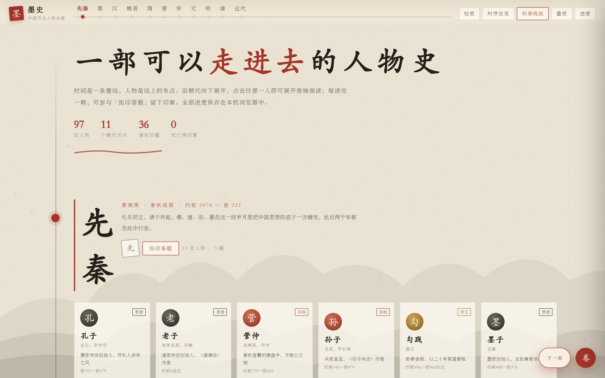
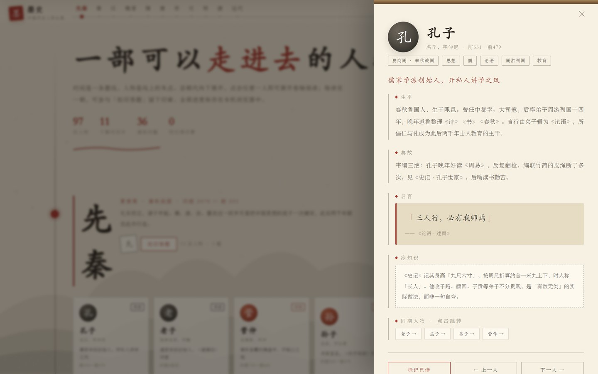
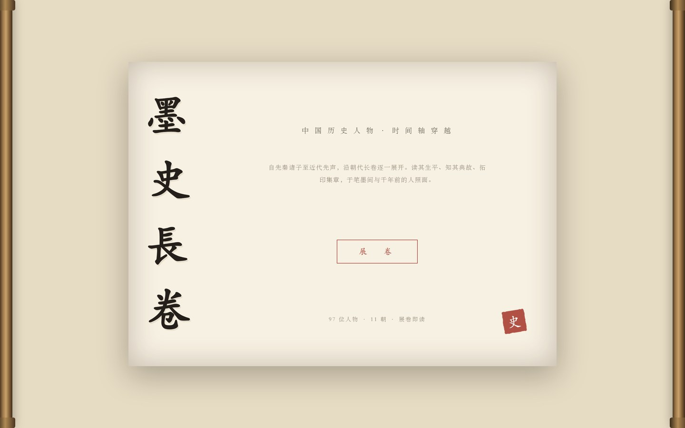

# 墨史 · 中国历史人物长卷

一部可以走进去的中国人物史。以**水墨卷轴**为形的单页可视化站点：竖向长卷从先秦铺到近代，97 位人物挂在时间墨线上，可答题集印章、可科举挑战，全部离线可用。

**在线体验** → <https://evanjason.github.io/history-chronicle/>



## 内容规模

| 项目 | 数量 | 说明 |
|---|---|---|
| 历史人物 | 97 位 | 超出最常见的「精选 60 人」体量 |
| 朝代切片 | 11 个 | 先秦 → 秦汉 → 魏晋 → 隋唐 → 宋 → 元 → 明 → 清 → 近代 |
| 史料辨析题 | 36 道 | 每朝 3 题，答对过半落一枚朱红印章 |
| 每人字段 | 8 项 | 字号、生卒、身份、定位、生平、典故、名言出处、冷知识 |

## 玩法与交互

主线是**时间轴穿越**，教育与娱乐都嵌在这条主线里，不额外堆独立模块：

- **卷轴开场**：纸面横向展开，竖排题字，点「展卷」进入
- **朝代尺**：顶部刻度尺随滚动朱红高亮，点击直达；右下「下一朝」带墨迹转场一次性穿越
- **人物详情**：点开人物卡，右侧展开册页，含「同期人物」可继续跳转（人工指定关系 + 同朝时间相邻自动补位）
- **拓印答题**：每朝答对过半落一枚印章，集齐 11 枚铺满印墙
- **科举挑战**：随机抽 10 题、连击加分，按答对率评级（童生 → 状元）
- **检索与筛选**：支持姓名、典故、关键词（如「造纸」「圆周率」）检索，以及按身份筛选
- **双主题**：宣纸 / 墨夜，进度存 `localStorage`
- **键盘**：`←` `→` 切朝代、`/` 检索、`Esc` 关闭

| 人物详情 | 卷轴开场 |
|---|---|
|  |  |

## 教育上的处理：不把小说当信史

历史科普站最容易出问题的地方是把文学作品、影视印象混进史实。本项目对每个存疑点都明确标注：

- **花木兰**：标注为文学形象，并说明「姓花」出自明代徐渭杂剧，非史书记载
- **《后出师表》《满江红》《胡笳十八拍》**：作者归属存疑，正文写出争议与出处
- **兰亭真迹、毛延寿画工、「精忠/尽忠报国」**：均注明传说与史料的分野
- **陈汤「犯强汉者虽远必诛」**：注明是汉廷将士语，非武帝原话

题目也偏向史料辨析而非死记硬背，例如：蔡伦不是发明纸而是改进造纸工序；虎门销烟用的是海水浸泡而非火烧。

## 技术实现

- **单文件**：整个站点就是一个 `index.html`，零依赖、零构建、无 CDN、无后端，双击即开
- **样式**：CSS 变量驱动双主题；宣纸纹理与墨山视差用纯 CSS `radial-gradient` + 分层 `translateY`
- **数据**：人物、朝代、题库全部内嵌为 JS 数据结构，无接口请求
- **持久化**：`localStorage`（key `ink_chronicle_v1`），存已读人物、印章、最高分；不可用时降级为会话内进度并提示
- **响应式**：适配 1920×1080 → 320×568，开场页用高度感知布局，字号同时受 `vw` 与 `vh` 约束
- **动效节制**：转场有防重入锁（一次点击一次动画），末朝自动禁用；尊重 `prefers-reduced-motion`

## 本地运行

```bash
git clone https://github.com/EvanJason/history-chronicle.git
cd history-chronicle
# 直接双击 index.html，或起个静态服务：
python -m http.server 8080
```

> URL 加 `#open` 可跳过开场动画直接进入。

## 已知取舍

- 进度只存本机浏览器，清缓存即丢失，无云端同步（避免引入后端）
- 人物数为 97，未做全量通史；选人标准是「每个朝代挑最有代表性的思想、事功、文艺与技术人物」
- 传说人物的画像与头像一律用印章式字符占位，不做无据的想象性还原

## License

内容整理与代码采用 [MIT](LICENSE)。史实参考《史记》《汉书》《三国志》《资治通鉴》等正史及权威工具书，标注处已尽量给出具体出处。
